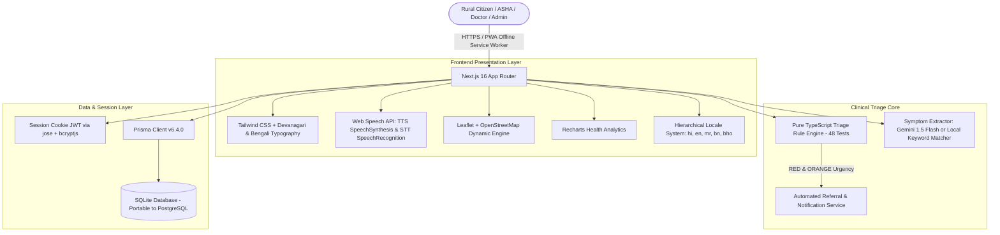

# Aarogya Path (आरोग्य पथ)
> **"Right care, right time, right place" | "सही इलाज, सही समय, सही जगह"**

[](https://nextjs.org/)
[](https://www.typescriptlang.org/)
[](https://tailwindcss.com/)
[](https://www.prisma.io/)
[](https://vitest.dev/)
[](#security-and-dpdp-act-2023-compliance)

A complete, production-structured multilingual rural telehealth triage and referral web application designed for India. It allows rural citizens and frontline health workers (ASHAs/ANMs) to describe symptoms by voice or tap in their local languages, computes urgency via a transparent pure TypeScript clinical rule engine, provides immediate first-aid guidance, and maps the nearest suitable public healthcare facility.

---

## 1. Quick Start & Setup

### Prerequisites
- Node.js 18+ (tested on Node 20 / 22)
- npm 9+

### Installation & Launch

```bash
# 1. Install dependencies
npm install

# 2. Run Prisma database migration (SQLite)
npx prisma migrate dev --name init

# 3. Seed demo accounts (Patient, ASHA, Doctor, Admin) and 26 facilities
npm run seed

# 4. Start local development server
npm run dev
```

Open [http://localhost:3000](http://localhost:3000) in your browser.

To run the full clinical rule unit test suite:
```bash
npm test
```

---

## 2. Seeded Demo Accounts Reference

All demo accounts come pre-configured with active session credentials:

| Role | Username / Identifier | Password | Access / Dashboard URL |
| :--- | :--- | :--- | :--- |
| **1. Villager / Patient** | `patient@aarogyapath.in` *(or `9876543210`)* | `Aarogya@123` | [`/triage`](http://localhost:3000/triage) & [`/patient/history`](http://localhost:3000/patient/history) |
| **2. Health Worker (ASHA)** | `asha@aarogyapath.in` *(or `9876543211`)* | `Asha@123` | [`/asha/dashboard`](http://localhost:3000/asha/dashboard) |
| **3. Doctor / Medical Officer** | `doctor@aarogyapath.in` *(or `9876543212`)* | `Doctor@123` | [`/doctor/dashboard`](http://localhost:3000/doctor/dashboard) |
| **4. District Health Admin** | `admin@aarogyapath.in` *(or `9876543213`)* | `Admin@123` | [`/admin/dashboard`](http://localhost:3000/admin/dashboard) |

> **Tip:** You can also click the quick demo buttons on the home screen or login page to log in instantly.

---

## 3. Architecture & System Design



---

## 4. Clinical Triage Rule Engine Documentation

The triage engine is implemented as a **pure TypeScript module** with **zero network dependencies** at [`src/lib/triage/engine.ts`](file:///d:/Techyuva/src/lib/triage/engine.ts). The rules are doctor-reviewable at [`src/lib/triage/rules.ts`](file:///d:/Techyuva/src/lib/triage/rules.ts).

### Severity Levels
1. **`RED` (Immediate Emergency)**: Immediate call to 108 / 112; rush to the nearest emergency hospital.
2. **`ORANGE` (Urgent Evaluation)**: Visit nearest PHC / CHC / Hospital today.
3. **`YELLOW` (Semi-Urgent)**: Consult a primary doctor or teleconsult within 24 to 48 hours.
4. **`GREEN` (Home Care)**: Home care, hydration, rest, and monitor symptoms.

### Core Principles
- **Red Flags Always Win**: Evaluated first. Examples:
  - `RF-01`: Chest pain radiating to left arm/jaw or squeezing pressure (Suspected Acute Coronary Syndrome).
  - `RF-02`: Severe breathlessness at rest or inability to speak a sentence in one breath.
  - `RF-03`: Unconsciousness, fainting, fits/convulsions, sudden confusion.
  - `RF-04`: Stroke FAST signs (facial droop, arm weakness, slurred speech).
  - `RF-05`: High-risk pregnancy danger signs (vaginal bleeding, severe headache with vision changes, fits, reduced movement).
  - `RF-06`: Young infant ($< 2$ months) with fever, poor feeding, or grunting.
  - `RF-07`: Suspected venomous snake bite or deep rabid animal bite.
  - `RF-08`: Hematemesis (vomiting blood), melena (black tarry stool), or profuse bleeding.
  - `RF-09`: Severe dehydration with shock (no urine in 12 hours, unable to drink fluids).
- **Risk Modifiers**: Step up urgency level by $+1$ tier for vulnerable patients:
  - Age $< 5$ or $> 60$ (`MOD-01`)
  - Active Pregnancy (`MOD-02`)
  - Chronic comorbidities: Diabetes, Hypertension, Heart disease, Asthma, TB (`MOD-03`)
  - Multiple symptoms combined ($\ge 3$ symptoms) (`MOD-05`)
- **Round-Up Principle**: Any uncertain or ambiguous answers (`NOT_SURE`, `UNCERTAIN`, `CANNOT_TELL`) clinically round urgency **UP**, never down.
- **Role of AI**: Gemini API is strictly limited to extracting symptom IDs from voice/text transcripts. **AI NEVER decides severity.**

---

## 5. Multilingual Localization Guide

Aarogya Path uses a typed JSON dictionary system located in `src/locales/`:
- [`hi.json`](file:///d:/Techyuva/src/locales/hi.json): 100% complete Hindi translations.
- [`en.json`](file:///d:/Techyuva/src/locales/en.json): 100% complete English translations.
- [`mr.json`](file:///d:/Techyuva/src/locales/mr.json): Marathi starter files.
- [`bn.json`](file:///d:/Techyuva/src/locales/bn.json): Bengali starter files.
- [`bho.json`](file:///d:/Techyuva/src/locales/bho.json): Bhojpuri starter files.

### How to Add a New Language (e.g. Tamil `ta` or Telugu `te`)
1. Create `src/locales/ta.json` by copying `src/locales/en.json`.
2. Translate the values into Tamil.
3. In [`src/lib/i18n.tsx`](file:///d:/Techyuva/src/lib/i18n.tsx):
   - Import `taLocale from '../locales/ta.json';`
   - Add `{ code: 'ta', name: 'Tamil', nativeName: 'தமிழ்', speechCode: 'ta-IN' }` to `SUPPORTED_LANGUAGES`.
   - Add `ta: taLocale` to `dictionaries`.

Missing keys automatically fall back to Hindi (`hi`), then English (`en`).

---

## 6. How to Add Real Healthcare Facility Data

The platform comes pre-seeded with 26 verified demo health centres across Uttar Pradesh.

### Method A: Via Admin Dashboard CSV Import
1. Log in as District Admin (`admin@aarogyapath.in`).
2. Go to **अस्पताल प्रबंधन (Facilities)** $\to$ **बल्क CSV आयात**.
3. Paste CSV lines with the following header format:
   ```csv
   name,type,district,address,phone,lat,lng
   Community Health Centre Sidhauli,CHC,Sitapur,NH-24 Sidhauli,05862-282400,27.2833,80.8333
   ```
4. Click **CSV से आयात करें** to immediately persist.

### Method B: Via Database Migration or Seed Script
Add facility records directly to [`prisma/seed.ts`](file:///d:/Techyuva/prisma/seed.ts) and run:
```bash
npm run seed
```

---

## 7. Security and DPDP Act 2023 Compliance

- **Explicit Consent**: Transparent consent modal during patient registration specifying the purpose of data collection.
- **Data Minimisation**: Collects only age, sex, village, pregnancy status, and relevant chronic comorbidities.
- **Right to Erasure (Right to be Forgotten)**: Patients can permanently delete their profile, assessment history, and related records with one click in the Patient Portal.
- **Role-Based Access Control**: Strict route checks protecting ASHA, Doctor, and Admin workspaces.
- **Rate Limiting**: Sliding-window rate limiter protecting login and triage endpoints from automated abuse.
- **Audit Trails**: All record views, updates, and triage runs are logged in the `AuditLog` table.

---

## 8. Clinical Safety Notice

> [!CAUTION]
> **Clinical Safety & Medical Disclaimer**
> 1. **Not a Medical Device**: Aarogya Path is an algorithmic clinical decision-support and navigation tool designed to assist health workers and rural citizens in determining triage urgency. It does NOT diagnose diseases, prescribe medical treatment, or replace licensed physicians.
> 2. **Review Requirement**: All rules provided in `src/lib/triage/rules.ts` are sample evidence-informed rules that **MUST be reviewed, customized, and formally approved by licensed medical doctors and district health authorities before any real-world clinical deployment**.
> 3. **Emergency Escalation**: In any acute or life-threatening emergency, users are instructed to immediately dial **108** (National Ambulance Service) or **112** (Emergency Response Support System).

---

## 9. Known Limitations

- **Speech Recognition Hardware & Browser Compatibility**: Browser Speech-to-Text (`webkitSpeechRecognition`) requires microphone permissions and depends on Chromium browser speech services. On unsupported browsers, the platform gracefully degrades to touch-based symptom selection.
- **Offline Maps**: While the app shell and core triage engine work fully offline via the PWA service worker, live OpenStreetMap map tiles require network connectivity. When offline, the nearest facility list and emergency phone numbers remain visible from cache.
- **Sample Data**: Seeded healthcare facilities and patient cases are explicitly marked as demo records.
